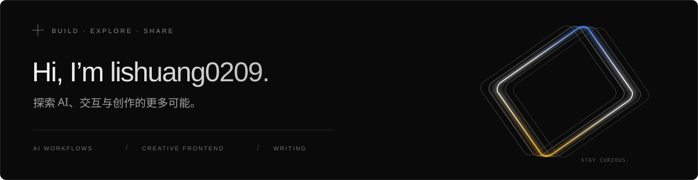

  

  <a href="https://lishuang0209.github.io/">个人网站 ↗</a>
  &nbsp; · &nbsp;
  <a href="#projects">开源项目</a>
  &nbsp; · &nbsp;
  <a href="#skills">技能与工具</a>
  &nbsp; · &nbsp;
  <a href="#writing">文章与写作</a>

## 关于我

你好，我是 **lishuang0209**。在 AI、设计与技术之间探索，把想法做成可以体验、使用和分享的作品。

- **AI 创作工作流**：把真实内容调研、文案生成、视觉风格与配图流程，整理成可复用的 Skill。
- **交互体验探索**：尝试滚动叙事、WebGL、3D 画廊与声音交互，让网页拥有更丰富的表达。
- **创作与分享**：通过开源项目、个人网站与公众号文章，记录实践和思考。
- **个人知识管理**：探索 Obsidian + Codex，把产品知识与实践笔记持续积累下来。

`AI 辅助开发` `Skills / MCP` `Creative Frontend` `交互设计` `产品知识管理` `内容创作`

## 🧩 全部公开项目

<!-- PROJECTS:START -->
### 01 / 小红书图文创作 Skill

**从真实笔记调研，到文案与配图的一套可复用工作流。**

面向支持 Skills 的 Cursor 与 Codex，将内容创作中的重复步骤整理成明确流程：先检索真实笔记，再生成内容，最后完成视觉输出。

- 调研同题参考笔记，核验来源及互动数据，支持合格缓存复用。
- 生成标题备选、正文和话题标签，提供 **10 种视觉风格**。
- 默认制作 3:4 竖版封面；内容页按需生成，附画幅校正与安装脚本。
- 提供功能展示页、安装说明与 MCP 接入文档。

**技术与工具** · `Agent Skills` `MCP` `Python` `Pillow` `AI 图文工作流`

[体验展示页 ↗](https://lishuang0209.github.io/xiaohongshu-content/) · [查看源码 ↗](https://github.com/lishuang0209/xiaohongshu-content) · [安装与使用](https://github.com/lishuang0209/xiaohongshu-content#快速安装)

---

### 02 / Blender 交互展示页

**将滚动叙事、3D 视觉与声音交互组合成一段网页体验。**

围绕 Blender 内容制作的独立概念展示页，探索从静态页面到可交互视觉叙事的转变。

- 滚动驱动的视频展开、曲面变形与连续章节过渡。
- 3D 翻转作品卡、WebGL 曲面轮播和指针局部显色。
- Three.js 角色展示、GSAP 动效、SVG 线条拨动与 Web Audio 声音反馈。
- 支持键盘操作、减少动态效果偏好，以及 WebGL 不可用时的回退。

**技术与工具** · `React` `TypeScript` `Three.js / WebGL` `GSAP` `Lenis` `Vite` `Web Audio`

[打开交互体验 ↗](https://lishuang0209.github.io/blender-landing-page/) · [查看源码与实现说明 ↗](https://github.com/lishuang0209/blender-landing-page)

独立概念项目，非 Blender 官方网站；媒体及第三方内容的来源说明见仓库。

---

### 03 / 个人网站

**一个关于作品、想法与日常的互联网空间。**

采用 Graphite 视觉方向：近黑背景、石墨细边框、紧凑白色标题，以及黄白蓝发光几何图形。

- 可切换的个人工作台、作品分类筛选和详情弹窗。
- 关于我、可展开随记，以及 GitHub 联系入口。
- 本地 SVG 与 CSS 图形、响应式布局和键盘交互。
- 通过 GitHub Actions 自动发布到 GitHub Pages。

**技术与工具** · `HTML` `CSS` `JavaScript` `SVG` `GitHub Actions` `GitHub Pages`

[访问个人网站 ↗](https://lishuang0209.github.io/) · [查看源码 ↗](https://github.com/lishuang0209/lishuang0209.github.io)

网站中的三个展示案例标注为示例项目；本页以上列出的是实际公开仓库。
<!-- PROJECTS:END -->

[浏览全部公开仓库 →](https://github.com/lishuang0209?tab=repositories&type=public)

## 🛠 技能与工具

以下是我在公开项目中正在实践的技术与方法。

**AI 工作流、内容创作与知识管理**

`Agent Skills` · `MCP 接入` · `提示词与流程设计` · `内容调研` · `AI 文案与配图` · `Python / Pillow`

`Obsidian + Codex` · `产品知识积累` · `实践笔记`

**前端与创意交互**

  
  
  
  
  
  
  

`WebGL` · `GSAP / ScrollTrigger` · `Lenis` · `SVG` · `Web Audio` · `滚动叙事` · `响应式与无障碍交互`

**工程与发布**

`Vite` · `Git / GitHub` · `GitHub CLI` · `GitHub Actions` · `GitHub Pages` · `静态网站部署`

## ✍️ 文章与写作

<!-- ARTICLES:START -->
围绕 AI 辅助创作、个人知识管理与技术观察，在微信公众号记录实践和思考。

### AI 辅助开发与交互创作

[**AI零代码做3D落地页：完整流程拆解附全提示词** ↗](https://mp.weixin.qq.com/s/NDDeExPvONx2e7c02f8m7Q)

`AI 辅助开发` · `3D 落地页` · `流程拆解` · `提示词`

### 产品知识管理

[**实操用Obsidian+Codex搭建一个能持续积累的产品知识库** ↗](https://mp.weixin.qq.com/s/VYoCFtJz50dWtEERfJwD_g)

`Obsidian` · `Codex` · `产品知识库` · `知识积累`

### 技术观察与思考

[**当 REA 号称逆向一切，真正带不走的东西是什么** ↗](https://mp.weixin.qq.com/s/6i2JO8WEyKlgmrdg3vdAUA)

`REA` · `逆向工程` · `技术观察`
<!-- ARTICLES:END -->

## 找到我

- **作品与日常**：[lishuang0209.github.io](https://lishuang0209.github.io/)
- **代码与探索**：[GitHub @lishuang0209](https://github.com/lishuang0209)
- **文章与写作**：[微信公众号文章](#writing)

---

保持好奇，持续构建。 · Built with curiosity.

