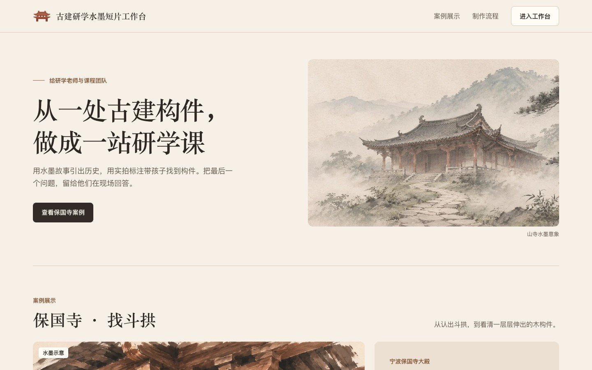
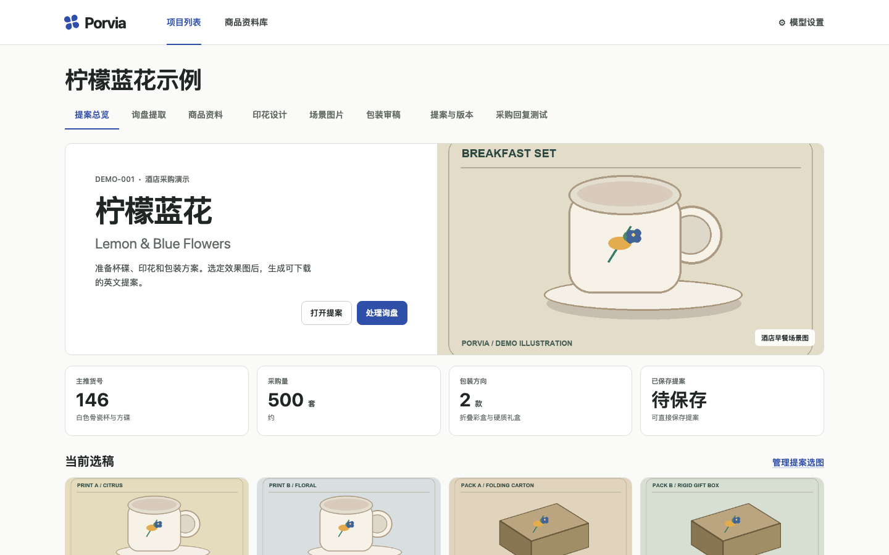
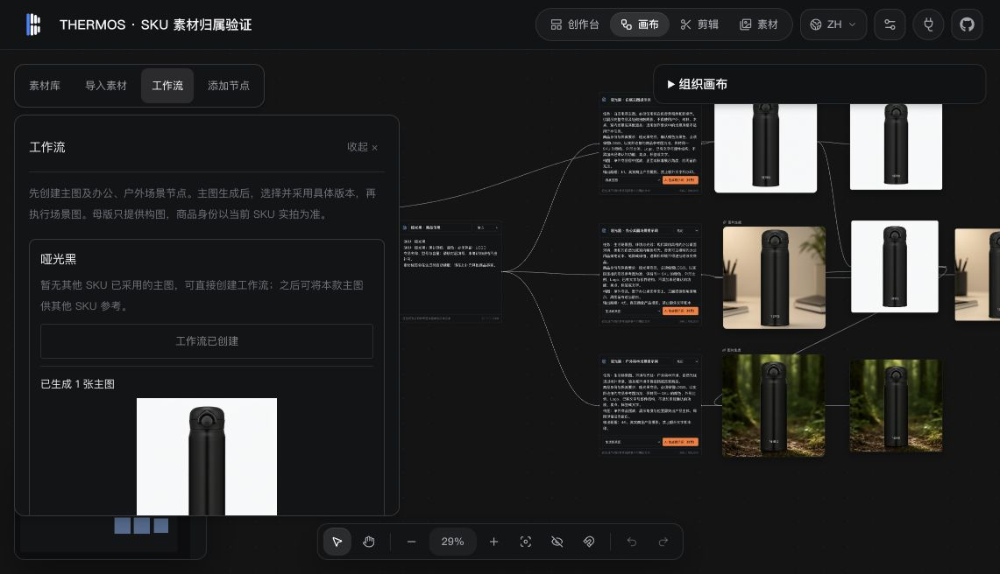
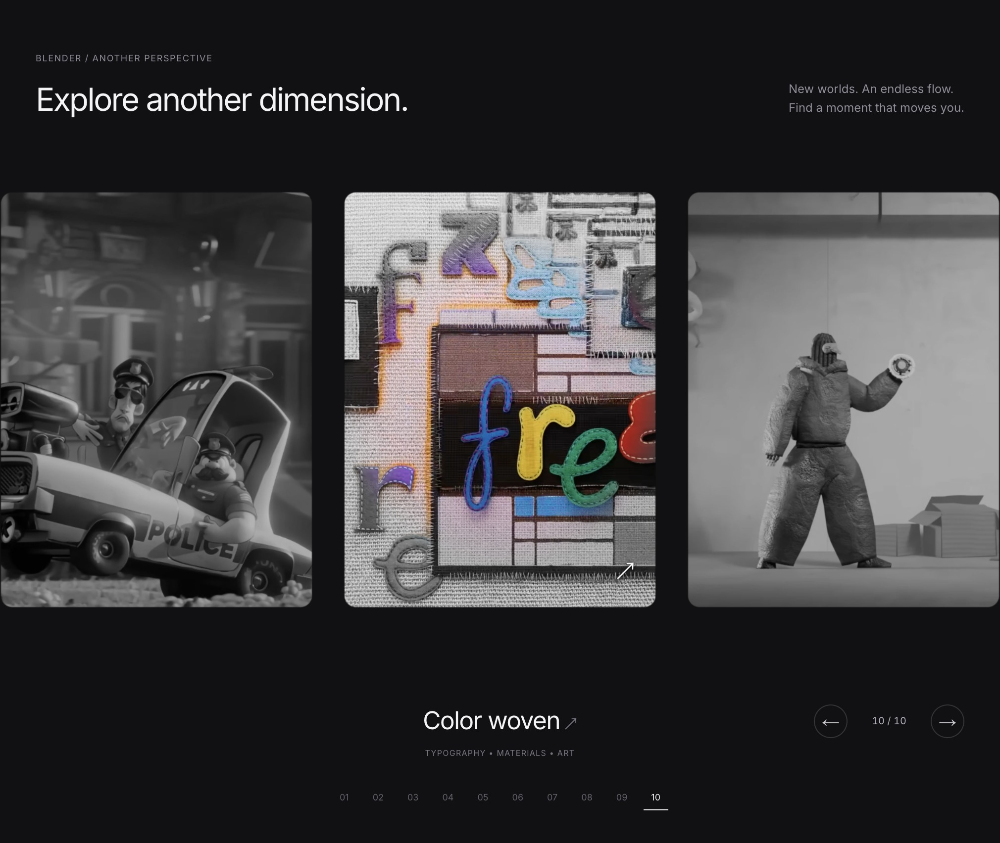

  

 

  
  
  

 

## 关于我

你好，我是 **李爽（lishuang0209）**。在 AI、设计与技术之间探索，把想法做成可以体验、使用和分享的作品。

- **AI 创作工作流**：把真实内容调研、文案生成、视觉风格与配图流程，整理成可复用的 Skill。
- **交互体验探索**：尝试滚动叙事、WebGL、3D 画廊与声音交互，让网页拥有更丰富的表达。
- **创作与分享**：通过开源项目、个人网站与公众号文章，记录实践和思考。
- **个人知识管理**：探索 Obsidian + Codex，把产品知识与实践笔记持续积累下来。

`AI 辅助开发` `Skills / MCP` `Creative Frontend` `交互设计` `产品知识管理` `内容创作`

## 项目

<!-- PROJECTS:START -->
### 01 / 墨观古建AI · 古建研学短片工作台

为古建研学老师和课程团队制作课堂内容。导入研学资料、标注实拍照片，编辑并审阅研学脚本，再导出水墨短片和 A4 观察任务卡。

`AI 研学` `Next.js` `FastAPI` `FFmpeg`

[项目官网 ↗](https://gujianyanxue.online/) · [项目源码 ↗](https://github.com/lishuang0209/moguan)

### 02 / 骨瓷出口工作台

面向骨瓷出口团队，从客户询盘中整理需求，集中管理产品资料、印花和包装审稿，并生成英文 PDF 提案。

`骨瓷出口` `Node.js` `SQLite`

[项目源码 ↗](https://github.com/lishuang0209/guci) · [本机运行说明 ↗](https://github.com/lishuang0209/guci#readme)

### 03 / 电商素材画布工作流

按 SKU 管理商品素材。在画布上串联素材入库、提示词编辑、白底主图、办公与户外场景图生成，以及结果保存。

`TypeScript` `Python`

[项目源码 ↗](https://github.com/lishuang0209/ecommerce-image-workflow) · [本机运行说明 ↗](https://github.com/lishuang0209/ecommerce-image-workflow/blob/main/README_ECOMMERCE.md)

### 04 / Blender · 交互展示页

围绕 Blender 制作的独立概念页。滚动时，视频画面逐渐展开并弯曲变形；浏览者也可以翻转 3D 作品卡、拖动 WebGL 曲面画廊，或拨动页尾的线条听取声音反馈。

`React` `TypeScript` `Three.js` `GSAP` `Web Audio`

[在线体验 ↗](https://lishuang0209.github.io/blender-landing-page/) · [项目源码 ↗](https://github.com/lishuang0209/blender-landing-page)

<!-- PROJECTS:END -->

## ✍️ 文章与写作

<!-- ARTICLES:START -->
[**AI零代码做3D落地页：完整流程拆解附全提示词** ↗](https://mp.weixin.qq.com/s/NDDeExPvONx2e7c02f8m7Q)

[**实操用Obsidian+Codex搭建一个能持续积累的产品知识库** ↗](https://mp.weixin.qq.com/s/VYoCFtJz50dWtEERfJwD_g)

[**当 REA 号称逆向一切，真正带不走的东西是什么** ↗](https://mp.weixin.qq.com/s/6i2JO8WEyKlgmrdg3vdAUA)

[**小米开源硬件 HachimoDock 亮相：150元复刻万能 AI 桌宠，从硬件拆解到万能场景全解析** ↗](https://mp.weixin.qq.com/s/q7Jv0Qh8uZe7CviEOxnDfg)
<!-- ARTICLES:END -->
